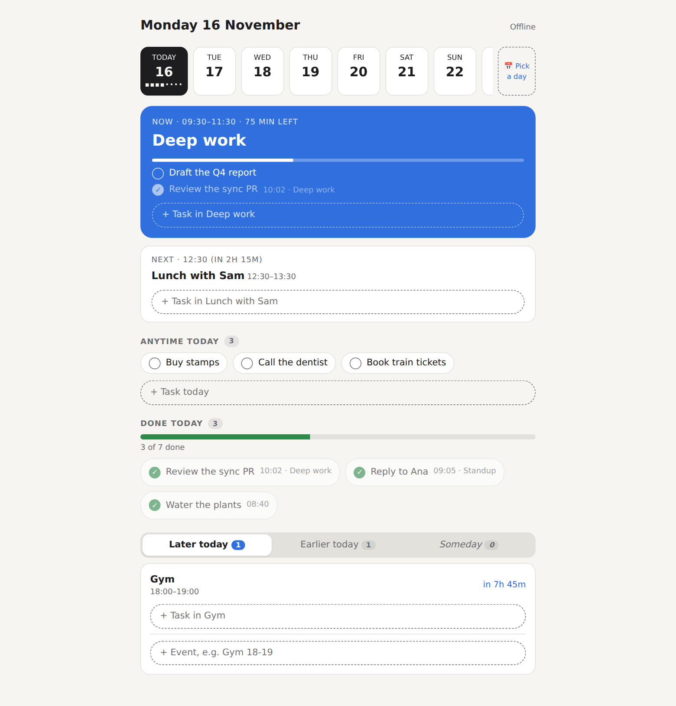
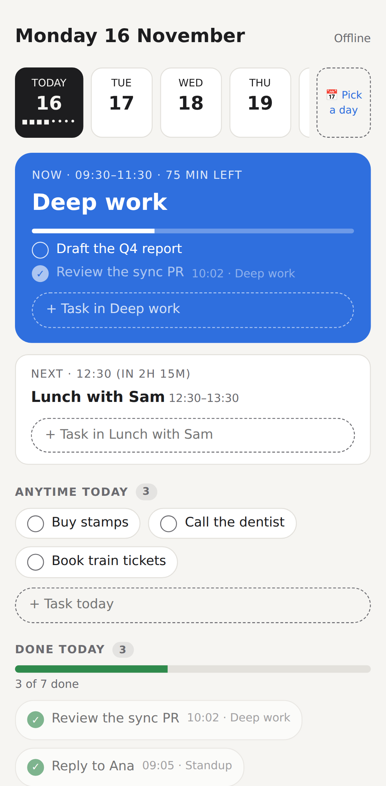

# factory-sandbox

Day Planner: a single-user, offline-first planner PWA.

I wanted to plan my day without facing a whole calendar. Calendar apps show weeks and months, and to-do apps don't know when I'm going to do things. Day Planner opens on **Today**: what is on now, what is next, what still needs a slot and what is done, with a small strip for planning the next few days. It runs on my phone and desktop, works offline, and syncs through a server on my own PC that only my private Tailscale network can reach.

<table>
  <tr>
    <td width="62%"></td>
    <td width="38%"></td>
  </tr>
  <tr>
    <td align="center"><sub>Today on desktop</sub></td>
    <td align="center"><sub>The same day on a phone</sub></td>
  </tr>
</table>

> **A green-field project built with agentic workflows.** I started from an empty repository. Agents did the research, the design prototypes, the spec, the tickets and the code; I made the decisions, reviewed the code and debugged it. Every step left a trace in this repo's issues, pull requests and branches, so the way it was built can be followed in full. See [The process](#the-process).

- Domain language: [GLOSSARY.md](GLOSSARY.md)
- Decisions: [docs/adr](docs/adr)
- Host setup (WSL2, Docker, Tailscale): [docs/host-setup.md](docs/host-setup.md)

## Features

- **Today at a glance**: a Now card for each live Event (time left, progress bar, the Tasks placed in it), Next, Anytime today for unplaced Tasks, a Done today progress bar with timed chips, and tabs for Later today, Earlier today and Someday.
- **Inline adding**: "+ …" fields where things belong: inside an Event card, under Anytime, at the end of Someday. An Event is one line, such as `Gym 18-19` or `18:30-19:15`.
- **Drag to plan**: drag a Task onto an Event to place it, onto a day or Anytime to date it, onto Someday to undate it. Drag an Event to another day and its placed Tasks come along. On a phone, press and hold starts the drag so scrolling still works.
- **Upcoming strip**: today and the next 7 days with counts, and "Pick a day" for anything later. Every day opens in the same layout as Today.
- **Sub-tasks**: one level deep, each placed on its own, so a large Task can be spread over several Events and days.
- **Completion times**: ticking off records the time, which can be edited later; the app works out which Event the work was done in.
- **Carry-over**: at local midnight, unfinished dated work moves to today and loses its Placement, even after several days closed. An overnight banner says what moved.
- **Recurrence**: every N days, on chosen weekdays or on a day of the month. Each Occurrence can be ticked, placed, moved or edited like a one-off; menu edits ask "Just this one" or "This and following". A recurring Task left undone when the next one arrives is closed as Skipped and kept as a record.
- **Offline and synced**: SQLite in the browser on each device, Postgres on the server, per-column last write wins. Installable as a PWA.

## Keyboard shortcuts

| Key | Action |
| --- | --- |
| `Enter` in a "+ …" field | Add the item and keep the field focused for the next one |
| `Esc` while dragging | Cancel the drag |

## Technologies

**Front end**
- React 19 and Vite, with `vite-plugin-pwa` for the service worker and install manifest.
- PowerSync Web: a local SQLite database (WASM) in each browser, so the app works offline.

**Planner core**
- `packages/core`: pure TypeScript holding every domain rule (Placement, Carry-over, Recurrence, series edits). The UI only asks it what is allowed, which makes it the main test seam.

**Back end and infrastructure**
- Postgres 17 with logical replication as the source of truth.
- PowerSync Open Edition, self-hosted, to stream changes to each device.
- A small Node API on Fastify: the upload endpoint, a long-lived JWT per device (`jose`), the JWKS, a proxy to PowerSync, and the built PWA.
- Docker Compose under Docker Desktop on WSL2, published on the tailnet with `tailscale serve`. The reasons are in [ADR 0001](docs/adr/0001-self-hosted-powersync-on-wsl2.md).

**Testing**
- Vitest for the core, and for the API against a real Postgres through Testcontainers.
- Playwright for end-to-end tests at a fixed clock, plus two-device sync tests.

**Workflow**
- Claude Code agents, driven by [Matt Pocock's skills](https://github.com/mattpocock/skills) (research, grilling, domain modelling, prototyping, TDD, code review).
- GitHub Issues as the tracker, with a GitHub Actions workflow ([board-sync.yml](.github/workflows/board-sync.yml)) that keeps a project board in step with triage labels.

## The process

The whole project, from idea to working app, ran through agents, with me deciding, reviewing and debugging at each stage.

1. **Mapping the unknowns.** I opened a [map issue](https://github.com/AkorNero/factory-sandbox/issues/1) for the MVP spec and split the open questions into research, grilling and prototype tickets.
2. **Research.** An agent compared offline-first PWA stacks and sync options ([#4](https://github.com/AkorNero/factory-sandbox/issues/4)): Dexie Cloud, PowerSync with Supabase, Firestore and a hand-built sync.
3. **Grilling sessions.** Agents questioned me on how Tasks, Sub-tasks and Events link ([#2](https://github.com/AkorNero/factory-sandbox/issues/2)), the repetition model ([#3](https://github.com/AkorNero/factory-sandbox/issues/3)), the stack ([#5](https://github.com/AkorNero/factory-sandbox/issues/5)) and edits to recurring items ([#8](https://github.com/AkorNero/factory-sandbox/issues/8)). Each answer went into [GLOSSARY.md](GLOSSARY.md) or an ADR, so later agents used the same words.
4. **Throwaway prototypes.** Several rounds of side-by-side variants for the Today screen and for adding and placing ([#6](https://github.com/AkorNero/factory-sandbox/issues/6), [#9](https://github.com/AkorNero/factory-sandbox/issues/9)); I picked one each time. They live on the `prototype/today-upcoming` branch.
5. **Spec and tickets.** The decisions became one self-contained spec written for agents ([#21](https://github.com/AkorNero/factory-sandbox/issues/21)), with user stories and Given/When/Then criteria, and then ordered end-to-end tickets (#22 to #32).
6. **Building in parallel.** Agents built each ticket test-first on its own branch in an isolated git worktree, and each branch was merged into the `spec/21-day-planner-mvp` integration branch ([PR #37](https://github.com/AkorNero/factory-sandbox/pull/37)).
7. **Review and debugging.** I reviewed the integrated code against the repo's standards and the spec, and the twelve review items were fixed on their own branch: numbered migrations, tombstones for deletes, soft deletes for Occurrences, and more. I debugged the problems that came up along the way.

One decision changed during the build: the server first ran under systemd, and I moved it to Docker Desktop (recorded in the ADR, with both setups kept in [docs/host-setup.md](docs/host-setup.md)).

## What I learned

- **Shared vocabulary is what keeps agents consistent.** Writing terms like Placement, Carry-over and Skipped into a glossary, with words to avoid, kept many agents working on separate branches using the same model.
- **Decisions are cheaper before the code.** Grilling and throwaway prototypes settled the hard rules (such as how "This and following" treats hand-edited Occurrences) before any ticket was built.
- **A pure core makes agent work checkable.** Keeping all rules in `packages/core`, with no I/O, let each ticket prove itself with fast tests, and let review focus on behaviour.
- **Deletes need tombstones under sync.** A resent PUT or PATCH could bring a deleted row back, so a DELETE now leaves a tombstone.
- **Postgres init scripts only run on an empty volume.** Schema changes need their own numbered, re-runnable migrations, run by a `migrate` job before the API starts.
- **Touch drag on iOS is subtle.** `touch-action: none` would block scrolling, and iOS Safari ignores `preventDefault` from a listener added mid-gesture, so the drag uses press-and-hold and a `touchmove` listener registered at mount.
- **Parallel worktrees need isolated test servers.** End-to-end runs in one worktree could reuse another worktree's server, so the port is now configurable and never shared.
- **The SQLite WASM is bigger than Workbox's 2 MiB precache default**, so the limit is raised in [vite.config.ts](apps/web/vite.config.ts).

## How it can be improved

- **Routines** (saved bundles added to a day by hand) are specified but not built yet; the screens are waiting on design ([#33](https://github.com/AkorNero/factory-sandbox/issues/33), [#34](https://github.com/AkorNero/factory-sandbox/issues/34)).
- **No backups.** The Postgres volume on one disk is the only durable copy; this is an accepted risk in the ADR for now.
- **Sync only runs while my PC is on** and WSL is running. Offline edits queue until then.
- **No reminders** (Web Push) in the MVP.
- Press-and-hold dragging still needs a final check on a real phone.
- Security rests on tailnet membership alone; any public exposure would need real authentication first.

## Layout

- `packages/core`: the planner core (pure TypeScript, the main test seam)
- `apps/web`: the React + Vite PWA (store adapter, clock, UI)
- `apps/api`: the Node API (upload endpoint, device token, JWKS, PowerSync proxy, serves the PWA) and the schema migrations (`apps/api/migrations`)
- `infra`: compose project, Postgres roles (`infra/postgres/init`), PowerSync config

## Run the server

```
cp infra/.env.example infra/.env     # then change the passwords (applied on first volume creation)
docker compose -f infra/compose.yaml up -d --build
curl -i http://127.0.0.1:8080/healthz
```

The app is then at `http://127.0.0.1:8080` (and on the tailnet through `tailscale serve`).

### Schema changes

The tables are made by numbered SQL files in `apps/api/migrations`, applied in order by the compose project's `migrate`
service on every `up` and recorded in `schema_migrations`. Postgres's own init scripts only run on an empty volume, so
they only make the roles and the publication. To change the schema, add the next numbered file; write it to be re-runnable
(`ADD COLUMN IF NOT EXISTS`, `CREATE TABLE IF NOT EXISTS`) and keep `packages/core/src/schema.ts` (the client's columns) in
step: an API test compares the two. To pick up a schema change on a running server:

```
docker compose -f infra/compose.yaml up -d --build    # migrate runs first, then the api restarts
docker compose -f infra/compose.yaml restart powersync  # so it reads the new columns
```

## Tests

```
npm ci
npm run test:core      # planner core, no Docker needed
npm run test:api       # upload endpoint + auth against a real Postgres (testcontainers; needs Docker)
npx -w apps/web playwright install chromium
npm run test:e2e       # Playwright smoke tests at a fixed clock; builds the app, no server needed
npm run test:e2e:sync  # two-device sync tests; needs the compose project above running
```
